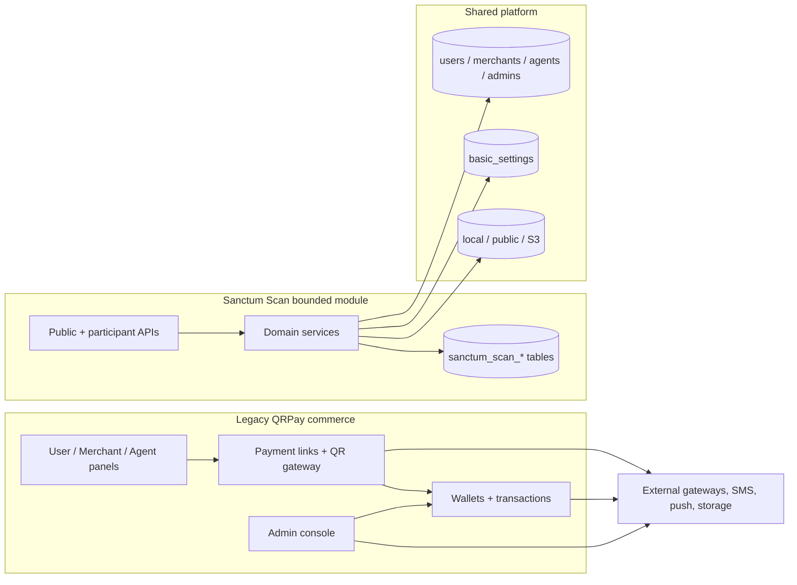

# Architecture Baseline — QRPay / Sanctum Scan

**Status:** QODOR-001 reconnaissance baseline  
**Date:** 2026-11-15  
**Branch examined:** `feature/qrpay-update` at `4ddb392` (18 commits ahead of `main`, 0 behind)  
**Scope:** Read-only investigation. No functional code was changed.

> **Update 2026-11-17 (QODOR-002, M017–M019):** the boot blocker is repaired. `php artisan --version` reports 12.72.0 and `composer check` reports 96 tests, 1,049 assertions, 1 skipped (the MySQL-only concurrency test). The MySQL job's step sequence (`migrate:fresh`, route-introspection fixture, `route:list --json`, backfill down/up, concurrency test) was executed green locally against MySQL 9.4; only the GitHub runner run is pending. The M016 settlement slice is implemented and covered by the matrices and suites listed in §9.6; the ADR 0016 gates and their CI workflow are wired; the admin operator middleware stack is verified by `AdminOperatorMiddlewareTest`; payment evidence is append-only and versioned, so rejection can be reopened by a buyer's new evidence (ADR 0018). Statements below marked as baseline findings remain historical evidence from the examined revision.

## Evidence conventions

- **Verified** — read directly from the repository or produced by an executed command in this session.
- **Hypothesis** — a reasoned inference that has not been proven by execution or production evidence.
- **Recommendation** — a proposed change, not an existing property of the system.

Line references use `path:line` and refer to the examined revision.

---

## 1. Executive summary

This repository is a single Laravel monolith with two overlapping product layers:

1. **Legacy QRPay commerce platform** — public site, separate user/merchant/agent account systems, wallets, transactions, payment links, a merchant QR payment gateway, bill pay, mobile top-up, remittance, gift cards, virtual cards, support, notifications, an admin console, and an embedded installer.
2. **Sanctum Scan protocol module (M002–M015)** — a bounded, layered extension implementing opaque scan references, an economic resource registry, bilateral exchanges, disputes, private evidence, independent verifier governance, attestation revisions, reassessments, and manual buyer identity review. Services in this module do **not** read or write legacy wallet or transaction tables.

The architecture is best described as a **modular monolith with a shared MySQL database and separate domain service layers**, authenticated by session guards for web panels and Laravel Passport for APIs. Laravel Sanctum is installed but is not used to protect routes.

**Critical baseline blocker (verified):** the examined branch cannot boot. Commit `4ddb392` committed unresolved merge-conflict markers in [`app/Models/Admin/BasicSettings.php`](app/Models/Admin/BasicSettings.php), line 37. Consequences:

- `php artisan --version` exits with a `ParseError`.
- `./vendor/bin/phpunit` reports 62 tests, **1 assertion, 61 errors**, all rooted in that parse error.
- The application cannot serve any request at this revision.

`main` contains a syntactically valid version of the same file, but mainline test execution was not completed in this session due to sandbox restrictions. Do not claim mainline tests pass without executing them.

Other principal architectural issues are a verification gap rather than a domain-design failure:

- CI originally ran only on `sanctum-scan/**` pushes and `main` PRs, executing one of four Sanctum Scan test files. As of 2026-11-16 it runs on every push and PR with the full suite, deterministic gates, and a MySQL job (M017); the MySQL job is wired but has not executed yet.
- Tests use hand-built SQLite schemas and bypass production middleware, so they cannot validate migrations, MySQL behaviour, or concurrency.
- The settlement state machine **was** an orphaned service and migration at the examined revision. As of 2026-11-16 it is wired, tested, and documented in §9.6.
- Documentation and milestone status have drifted from code (M012–M014 absent; ADR 0014 missing; ADR 0012 and ADR 0015 conflict).
- Legacy money paths contain unauthenticated or weakly authenticated webhooks, non-locking balance updates, and nested transactions.

See [`docs/engineering/RISK_REGISTER.md`](docs/engineering/RISK_REGISTER.md) for prioritisation.

---

## 2. System context

### Actors

| Actor | Surface | Authentication |
|---|---|---|
| Public visitor | Marketing site, public scan page, payment-link checkout | None |
| User (buyer) | User web panel, `api/*` user API | Session `web`; Passport `api` |
| Merchant | Merchant web panel, `merchant-api/*`, hosted QR checkout | Session `merchant`; Passport `merchant_api` |
| Agent | Agent web panel, `agent-api/*` | Session `agent`; Passport `agent_api` |
| Administrator | Admin panel under configurable prefix (default `/admin`) | Session `admin` + role permission + 2FA |
| Independent verifier | Sanctum Scan API routes | Same `api` user guard, verified membership/mandate |
| Platform reviewer | Admin evidence and identity review | Admin guard + role + 2FA |
| External payment/identity providers | Redirects, callbacks, webhooks | Mixed; see §7 |

### External systems

| Category | Integrations present in code/config |
|---|---|
| Card/bank gateways | Stripe, PayPal, Authorize.Net, Flutterwave, Paystack, Razorpay, CoinGate, Perfect Money, SSLCommerz, bKash, Pagadito, Tatum, manual gateway |
| Virtual cards | Stripe virtual cards, Sudo, Strowallet, CardyFie |
| Mobile top-up / bills | Reloadly-backed top-up, bill-pay categories |
| Messaging | SMTP, Mailgun, Twilio, Vonage, Pusher Beams/push |
| Storage | Local, public local, S3 |
| Geo / FX | GeoIP, currency-layer-style exchange-rate updates |
| Identity | Manual admin review only in Sanctum Scan; no biometric or third-party KYC integration |
| Commercial SDK | `reachead/laravel-sdk` from a custom Composer repository |

Gateway constants are defined in [`app/Constants/PaymentGatewayConst.php`](app/Constants/PaymentGatewayConst.php). Provider traits live in [`app/Traits/PaymentGateway/`](app/Traits/PaymentGateway).

---

## 3. Technology stack

| Layer | Technology | Verified version / constraint |
|---|---|---|
| Language | PHP | `^8.2` in `composer.json`; CI uses 8.2; local session used 8.4.13 |
| Framework | Laravel | locked `v12.72.0` |
| API auth | Laravel Passport | locked `v13.11.0` |
| Token package | Laravel Sanctum | locked `v4.4.0`; installed but unused for route protection |
| Admin 2FA | `pragmarx/google2fa` | present |
| Tests | PHPUnit | locked `11.5.57`; local vendor `11.5.58` |
| Code style | Laravel Pint | locked `1.30.4`; CI gate on changed files |
| Frontend | Vite 3, Bootstrap 5, Sass, Axios | `package.json`; no lockfile present, no build gate |
| Database | MySQL (production template) | `DB_CONNECTION=mysql` in `.env.example`; MySQL CI job wired and its step sequence green locally on MySQL 9.4 (GitHub run pending) |
| Test database | SQLite in-memory | tests override config and build schemas manually |
| Cache/session/queue | File / file / database | `.env.example`; scheduler runs queue worker every five minutes |
| Broadcasting | Pusher | `BROADCAST_DRIVER=pusher` |
| File storage | Local/public/S3 | `config/filesystems.php` |
| Dependency stance | `minimum-stability: dev`, custom Composer repository | `composer.json` |

The README’s technology direction (PostgreSQL, Redis, Docker, React/React Native) is **aspirational** and does not describe the current runtime ([`README.md`](README.md) §9).

---

## 4. Repository layout

| Path | Responsibility |
|---|---|
| [`app/Http/Controllers/`](app/Http/Controllers) | Web, admin, merchant, agent, user, API, QR gateway, installer-facing controllers |
| [`app/Services/SanctumScan/`](app/Services/SanctumScan) | Sanctum Scan domain services |
| [`app/Models/`](app/Models) | Legacy entities plus 25+ Sanctum Scan models |
| [`app/Http/Middleware/`](app/Http/Middleware) | Guard-specific auth, KYC, PIN, 2FA, maintenance, rate limiting |
| [`app/Http/Helpers/`](app/Http/Helpers) | Large global function surface, payment helpers, provider adapters |
| [`app/Traits/PaymentGateway/`](app/Traits/PaymentGateway) | Per-provider payment logic |
| [`routes/`](routes) | Route files split by actor and transport |
| [`database/migrations/`](database/migrations) | 205 migrations: legacy schema + 26 Sanctum Scan migrations |
| [`resources/views/`](resources/views) | Blade admin/merchant/agent/user/site/scan views; embedded installer views |
| [`public/`](public) | Front controller, frontend/backend assets, installer assets |
| [`tests/Feature/SanctumScan/`](tests/Feature/SanctumScan) | Sanctum Scan feature tests |
| [`docs/architecture/decisions/`](docs/architecture/decisions) | Historical ADR log 0001–0013, 0015 |
| [`docs/api/`](docs/api) | Sanctum Scan API guides |
| [`.github/workflows/`](.github/workflows) | Single CI workflow |

Scale (verified): 2,290 tracked files, 616 PHP files under `app/`, 205 migrations, 1,322 route verb declarations, 51 `withoutMiddleware(...)` usages across route files.

---

## 5. Entry points and request routing

### HTTP

- Standard production front controller: [`public/index.php`](public/index.php).
- A second front controller at [`index.php`](index.php) plus root [`.htaccess`](.htaccess) rewrites all requests into `public/`. This supports shared-hosting layouts where the document root cannot be changed. The root controller does **not** check the framework maintenance file that `public/index.php` checks.
- Recommendation: deploy with the document root set to `public/`; treat the root fallback as a compatibility path, not the primary topology.

### Route loading

[`app/Providers/RouteServiceProvider.php`](app/Providers/RouteServiceProvider.php) registers:

| Prefix / group | File | Middleware (summary) |
|---|---|---|
| `/api` | [`routes/api/api.php`](routes/api/api.php) | `system.maintenance.api`, `api` |
| `/merchant-api` | [`routes/api/merchant_api.php`](routes/api/merchant_api.php) | `system.maintenance.api`, `api` |
| `/agent-api` | [`routes/api/agent_api.php`](routes/api/agent_api.php) | `system.maintenance.api`, `api` |
| `/` | [`routes/web.php`](routes/web.php) | `web`, `system.maintenance` |
| `/user/*` | [`routes/user.php`](routes/user.php) | `web`, `auth`, verification, SMS, 2FA, maintenance |
| configurable admin prefix | [`routes/admin.php`](routes/admin.php) | route-local: `web`, `auth:admin`, `app.mode`, role guard, 2FA |
| `/merchant/*` | [`routes/merchant.php`](routes/merchant.php) | `web`, `auth:merchant`, verification, SMS, 2FA, maintenance |
| `/agent/*` | [`routes/agent.php`](routes/agent.php) | `web`, `auth:agent`, verification, SMS, 2FA, maintenance |
| `/` auth pages | [`routes/auth.php`](routes/auth.php) | `web`, maintenance |
| global/public | [`routes/global.php`](routes/global.php) | `web` |
| QR gateway API | [`routes/payment-gateway/qr_pay/v1/routes.php`](routes/payment-gateway/qr_pay/v1/routes.php) | `api` |
| QR demo checkout | [`routes/payment-gateway/qr_pay/v1/checkout.php`](routes/payment-gateway/qr_pay/v1/checkout.php) | `web`, maintenance |
| `/project/install/*` | [`resources/installer/src/routes/web.php`](resources/installer/src/routes/web.php) | `web` with installer-specific bypasses |

Public scan endpoints (verified):

- Web: `GET /scan/{reference}` → `SanctumScan\PublicScanController@show`, `throttle:60,1` ([`routes/web.php:25`](routes/web.php:25)).
- API: `GET /api/sanctum/v1/scan/{reference}` → `Api\Sanctum\ScanReferenceController`, `throttle:30,1` ([`routes/api/api.php:53`](routes/api/api.php:53)).

### CLI and background work

- Commands: `FileRename`, `RebuildDashboardStats`, `UpdateCurrencyRates` ([`app/Console/Commands/`](app/Console/Commands)).
- Scheduler: `queue:retry all` daily; `queue:work --stop-when-empty` every five minutes; `currency:update` daily ([`app/Console/Kernel.php:17`](app/Console/Kernel.php:17)).
- Queue tables: `jobs`, `failed_jobs`.
- No deployment scripts, Dockerfile, or process manager configuration are tracked.

### Route-boot side effects

`RouteServiceProvider::boot()` performs `Schema::hasTable('basic_settings')` and `BasicSettings::first()` on every request, swallowing all throwables ([`app/Providers/RouteServiceProvider.php:35`](app/Providers/RouteServiceProvider.php:35)). The result selects the admin prefix:

```php
Route::prefix($basic_settings->admin_prefix ?? 'admin')
```

If the database is unavailable or the settings row is absent, admin routes silently fall back to `/admin` ([`app/Providers/RouteServiceProvider.php:62`](app/Providers/RouteServiceProvider.php:62)). This is both a per-request query and a fail-open configuration path.

Additional boot-time reads: [`app/Providers/StorageServiceProvider.php:30`](app/Providers/StorageServiceProvider.php:30) and [`app/Http/Middleware/StartingPoint.php:31`](app/Http/Middleware/StartingPoint.php:31).

---

## 6. Authentication and authorization

### Guards

[`config/auth.php`](config/auth.php) defines:

| Guard | Driver | Provider | Used by |
|---|---|---|---|
| `web` | session | users | user web panel |
| `admin` | session | admins | admin panel |
| `agent` | session | agents | agent panel |
| `merchant` | session | merchants | merchant panel |
| `api` | Passport | users | `auth.api` routes |
| `merchant_api` | Passport | merchants | `merchant.api` routes |
| `agent_api` | Passport | agents | `agent.api` routes |

Sanctum’s `EnsureFrontendRequestsAreStateful` middleware is commented out ([`app/Http/Kernel.php:47`](app/Http/Kernel.php:47)); only `Admin` uses `HasApiTokens`; no route uses `auth:sanctum`. Sanctum is effectively dead surface in this revision.

### Admin authorization

Admin protected routes use `web`, `auth:admin`, `app.mode`, `admin.role.guard`, `admin.google.two.factor` ([`routes/admin.php:98`](routes/admin.php:98)). `RoleGuard` denies only when `auth_admin_incomming_permission()` returns false.

**Verified fail-open:** that helper returns `true` when the current route name is not present in `permission_protected()` ([`app/Http/Helpers/helpers.php:1298`](app/Http/Helpers/helpers.php:1298)). Unnamed admin routes, or routes registered after the permission list is built, are therefore accessible to any authenticated admin with any role. Eight routes are also unconditionally skipped ([`app/Http/Helpers/helpers.php:1197`](app/Http/Helpers/helpers.php:1197)).

### Sanctum Scan authorization

- Public resolution is unauthenticated and read-only.
- Buyer mutations require the `api` guard and, for acceptance/dispute/evidence, `user.pin.setup.guard` ([`routes/api/api.php:201`](routes/api/api.php:201)); payment evidence additionally requires `api.kyc` ([`routes/api/api.php:250`](routes/api/api.php:250)).
- Merchant mutations require `merchant.api` + status + 2FA; issuance requires `api.kyc`; state changes require merchant PIN setup ([`routes/api/merchant_api.php:102`](routes/api/merchant_api.php:102)).
- Participant scoping is implemented with ownership predicates and `lockForUpdate` inside service/controller transactions, e.g. buyer exchange lookup by `buyer_user_id` ([`app/Http/Controllers/Api/User/SanctumScanExchangeController.php:48`](app/Http/Controllers/Api/User/SanctumScanExchangeController.php:48)).
- Shared dispute/evidence controllers decide the acting guard from the request URL prefix in one path (`$request->is('merchant-api/merchant/*')`) — a routing-prefix coupling rather than an explicit guard contract.

---

## 7. Module boundaries



### Legacy commerce core

Controllers for user/merchant/agent/admin panels coordinate wallets, transactions, recipients, payment links, remittance, bill pay, top-up, gift cards, virtual cards, support, and reports. Domain logic is often in traits/helpers rather than services. Wallet models are thin Eloquent wrappers with no domain invariants.

### Payment gateway adapters

[`app/Traits/PaymentGateway/`](app/Traits/PaymentGateway) contains per-provider logic (redirect, callback, verification). The merchant QR gateway lives under [`app/Http/Controllers/PaymentGateway/QrPay/v1/`](app/Http/Controllers/PaymentGateway/QrPay/v1) and uses `payment_order_requests` as a short-lived order/token record.

### Sanctum Scan module

Layer contract:

- **Controllers** validate input, resolve the authenticated actor, enforce participant scoping, and delegate.
- **Services** own transactions, row locks, state preconditions, append-only event writes, and evidence integrity.
- **Models** are persistence wrappers; most state-changing operations go through services, but models such as `SanctumScanExchange` use `$guarded = ['id']`, so direct mass assignment is not structurally prevented ([`app/Models/SanctumScanExchange.php:14`](app/Models/SanctumScanExchange.php:14)).
- **Database** uses a dedicated `sanctum_scan_*` namespace with foreign keys to `users`, `merchants`, and `admins`.
- **No ledger coupling:** Sanctum Scan services import `User`, `Merchant`, and `BasicSettings`; they do not import or write `Transaction`, `UserWallet`, `MerchantWallet`, `AgentWallet`, or `PaymentOrderRequest` (verified by search).

### Cross-cutting concerns

- **Global helpers:** Composer autoloads five helper files ([`composer.json`](composer.json)); `helpers.php` contains routing/permission logic, file paths, gateway helpers, and formatting. This is a high-fan-in surface.
- **Settings singleton:** `BasicSettings` is read during boot, in providers, in middleware, and in domain services. The table is a single-row configuration dependency.
- **Admin prefix:** Derived from the settings row at route registration time.
- **Installer:** Full installer code ships in the application and is registered whenever the route file exists ([`app/Providers/RouteServiceProvider.php:109`](app/Providers/RouteServiceProvider.php:109)).

---

## 8. Data architecture

### Schema inventory

- 205 migrations total.
- 26 Sanctum Scan migrations dated 2026-11-13/14.
- Core legacy tables include `users`, `admins`, `agents`, `merchants`, `user_wallets`, `merchant_wallets`, `agent_wallets`, `transactions`, `transaction_charges`, tenant KYC tables, `developer_api_credentials`, `payment_order_requests`, `gateway_settings`, `payment_links`, `jobs`, `failed_jobs`.
- Sanctum Scan tables: references, resources, provenance events, exchanges, exchange events, payment evidence, disputes, dispute messages, dispute evidence, evidence reviews, verifier institutions, memberships, mandates, independent attestations, registry events, credential reviews, conflict declarations, appeals, appeal decisions, attestation revisions, reassessments, user identity checks.

Representative schema properties (verified):

- Scan references store only `reference_hash` (SHA-256) plus status/expiry/audit fields; the raw token is not persisted ([`database/migrations/2026_11_13_130000_create_sanctum_scan_references_table.php`](database/migrations/2026_11_13_130000_create_sanctum_scan_references_table.php)).
- Resources have a unique `(merchant_id, resource_type, reference_code)` constraint and cascade from merchants ([`database/migrations/2026_11_13_150000_create_sanctum_scan_resources_table.php:34`](database/migrations/2026_11_13_150000_create_sanctum_scan_resources_table.php:34)).
- Exchanges snapshot resource name/reference, quantity, unit, amount, currency, terms, and expiry; FKs to merchant, buyer, and resource have no delete rule ([`database/migrations/2026_11_13_160000_create_sanctum_scan_exchanges_table.php:33`](database/migrations/2026_11_13_160000_create_sanctum_scan_exchanges_table.php:33)).
- One payment-evidence row per exchange; one dispute per exchange.
- Event tables are append-only by convention: they carry `created_at` but no `updated_at`, and no update paths exist in services.
- Attestation revisions enforce unique `(attestation_id, version)` and unique `previous_revision_id`, forming a single chain.
- `users` carries the current identity projection (`identity_verified_at`, `identity_verification_method`); the history lives in `sanctum_scan_user_identity_checks`.
- `basic_settings` carries `sanctum_exchange_identity_gate` (default false).
- `sanctum_scan_exchanges` gained `settlement_status` and `settlement_status_updated_at` in [`database/migrations/2026_11_14_110000_add_settlement_status_to_sanctum_scan_exchanges_table.php`](database/migrations/2026_11_14_110000_add_settlement_status_to_sanctum_scan_exchanges_table.php), but the field is not read or written anywhere except the orphaned service.

### State enforcement

There are no database `CHECK` constraints for status columns. State validity is enforced by application code and, in some services, row locks and `DB::transaction`. Models generally do not guard status transitions themselves.

### Files

- Sanctum Scan dispute evidence is stored on the private `local` disk under application-generated names, with detected MIME, size, SHA-256 digest, and participant-scoped access ([`app/Services/SanctumScan/DisputeEvidenceManager.php`](app/Services/SanctumScan/DisputeEvidenceManager.php)).
- Legacy uploads use the default disk. `.env.example` sets `FILESYSTEM_DISK="public"`, so legacy profile/KYC-like uploads may be publicly addressable depending on deployment configuration.
- The public `file/download/{path_source}/{name}` route is unauthenticated and serves files from a fixed slug-to-directory map ([`routes/global.php:34`](routes/global.php:34), [`app/Http/Helpers/helpers.php:481`](app/Http/Helpers/helpers.php:481)).

### Environments

- Production template: MySQL, file cache/session, database queue.
- CI/tests: SQLite in-memory for the gate job; MySQL 8 service for the migration and concurrency job.
- The MySQL job's full step sequence was executed locally against a disposable MySQL 9.4 instance on 2026-11-17 and is green; execution on the GitHub runner is still pending (R-02).

---

## 9. Principal flows

### 9.1 Legacy merchant QR payment

Evidence: [`app/Http/Controllers/PaymentGateway/QrPay/v1/AuthenticationController.php`](app/Http/Controllers/PaymentGateway/QrPay/v1/AuthenticationController.php), [`PaymentController.php`](app/Http/Controllers/PaymentGateway/QrPay/v1/PaymentController.php), [`payment_order_requests` migration](database/migrations/2023_05_09_105630_create_payment_order_requests_table.php).

1. Merchant generates `client_id`/`client_secret` credentials.
2. Merchant exchanges credentials for a short-lived order token; a `payment_order_requests` row is created with status `CREATED`.
3. Hosted checkout authenticates the payer.
4. `paymentConfirm` validates the order, debits/credits wallets or charges a card, and sets the order to `SUCCESS`.
5. The merchant is redirected with query parameters. No server-to-server merchant settlement webhook is defined in the QR gateway routes.

Observed weaknesses:

- Balance updates are read-modify-write without `lockForUpdate` ([`PaymentController.php:708`](app/Http/Controllers/PaymentGateway/QrPay/v1/PaymentController.php:708)); concurrent confirms are a **hypothesis-level** double-spend risk and need a concurrency test.
- Stripe card tokenisation/charge occurs before the order-null and status checks ([`PaymentController.php:232`](app/Http/Controllers/PaymentGateway/QrPay/v1/PaymentController.php:232), status check at line 387).
- The order status is not enforced at the database level; replay/double-confirm protection depends on the controller check.

### 9.2 Public scan resolution

1. `GET /scan/{reference}` or `GET /api/sanctum/v1/scan/{reference}`.
2. Strict regex `snc_[A-Za-z0-9_-]{43}`.
3. SHA-256 lookup on `reference_hash`; requires `status=active`, no `revoked_at`, and no expiry in the past.
4. Merchant resources additionally require `status=published` and an active, non-deleted merchant.
5. Returns a presentation-safe document. Public output is explicitly merchant-declared; no payment, ownership proof, or verification is implied.

The resolver exposes declared quantity/unit per ADR 0013 ([`app/Services/SanctumScan/ScanReferenceResolver.php`](app/Services/SanctumScan/ScanReferenceResolver.php)).

### 9.3 Economic exchange

State machine:

```text
offered -> accepted -> dispatched -> received
   |           |
   +-> declined|
   +-> cancelled
   +-> expired
```

- Merchant issues an offer only for its own published resource to an eligible buyer; the exchange snapshots resource identity, quantity, unit, amount, currency, terms, and expiry.
- Buyer accepts only an offer addressed to its account; acceptance is wrapped in a transaction and locks the exchange. Optional identity gate returns `403 buyer_identity_unverified`; the exchange stays `offered`.
- Merchant dispatches only after acceptance. Buyer confirms receipt only after dispatch.
- All actions append actor-attributed events.
- Buyer may submit **one** payment reference in `accepted|dispatched|received`; amount and currency must match exactly. Evidence is immutable and unverified.
- No wallet, transaction, refund, or settlement state changes occur in this flow.

### 9.4 Dispute, evidence, and independent verification

- One dispute per exchange; either participant may open it after acceptance.
- Dispute transitions: `open -> resolution_proposed -> resolved`, with rejection returning to `open`; withdrawal only by the initiator before a counterparty response.
- Evidence: PDF/JPEG/PNG, max 10 MiB, private storage, SHA-256 bound, duplicate digest rejected per dispute.
- Admin review is append-only and hash-bound; decisions are `verified|rejected|unable_to_verify`.
- Verifier governance: institution registry, invited memberships, scoped mandates, credential reviews, conflict declarations, immutable attestations, appeals/decisions, versioned corrections/withdrawals, and reassessment by a different member under a new mandate.
- None of these flows move funds or change exchange/dispute settlement state.

### 9.5 Manual buyer identity review

- Admin records an append-only check (`verified|rejected|unable_to_verify`) with method, optional internal reference, summary, reviewer, and timestamp.
- The user row holds only the current projection; a later non-verified result clears it.
- Gate disabled by default; when enabled, acceptance locks settings then the buyer row, serialising against reviews.
- Merchant responses never expose identity-review state.

### 9.6 Settlement (implemented, records truth only)

Settlement is a protocol record of what participants claim and what an administrator has verified. It never moves funds and never reads or writes legacy wallet or transaction tables.

- [`SettlementStateMachine`](app/Services/SanctumScan/SettlementStateMachine.php) is the single transition table. Only `admin` may verify, reject, or settle; `system` is not a superuser.
- [`ExchangeSettlementManager`](app/Services/SanctumScan/ExchangeSettlementManager.php) applies transitions inside a locked transaction and appends exactly one `settlement_status_changed` event per change. Closed-exchange paths reuse it inside their existing locked transaction.
- Buyer payment-reference submission writes the unverified evidence row, the evidence event, and the `awaiting_payment -> payment_evidence_submitted` transition in one transaction ([`SanctumScanExchangeController.php`](app/Http/Controllers/Api/User/SanctumScanExchangeController.php)).
- Administrators inspect and advance settlement through [`SanctumScanExchangeSettlementController.php`](app/Http/Controllers/Admin/SanctumScanExchangeSettlementController.php); errors are typed (`invalid_settlement_transition`, `already_in_state`, `stale_expected_status`).
- Buyer and merchant projections include `settlement_status` and `settlement_status_updated_at`; public scan payloads never expose it.
- [`2026_11_16_120000_backfill_settlement_status_for_closed_exchanges.php`](database/migrations/2026_11_16_120000_backfill_settlement_status_for_closed_exchanges.php) reconciles exchanges closed before settlement tracking existed. It is reversible and idempotent.

`settled` is an administrative record, not proof that funds were received or that a payment provider confirmed a transfer.

---

## 10. Coupling and boundary observations

| Observation | Evidence | Assessment |
|---|---|---|
| Shared database, separate table namespace | Sanctum Scan migrations use `sanctum_scan_*`; FKs to legacy tables | Good modular boundary; extraction remains possible |
| No ledger coupling in Sanctum Scan | No imports/writes of wallet/transaction models in services | Strong invariant; preserve it |
| Settings row read during route boot | `RouteServiceProvider.php:35` | Availability and fail-open risk; admin prefix depends on data |
| Global helper functions | `helpers.php` autoloaded via Composer | High fan-in; hard to test/secure consistently |
| URL-prefix guard sniffing | Shared dispute evidence controller | Fragile if prefixes change; prefer explicit guard resolution |
| Duplicate identity admin surfaces | `SanctumScanUserIdentityController` and `SanctumScanUserIdentityReviewController`; duplicate route-name prefix `sanctum.identity-checks.` | Inconsistent validation and ambiguous route names |
| Broad mass assignment | Sanctum Scan models use `$guarded = ['id']` | Domain services are the only intended writers, but the model does not enforce it |
| Docs as source of truth | Roadmap/README/ADR claims exceed code in places | Needs executable capability verification |

---

## 11. Failure points

Architecture-level failure points, in priority order:

1. **Boot-time parse error** at HEAD (availability).
2. **Unauthenticated state-changing webhooks** for mobile top-up and Flutterwave withdrawal callbacks ([`routes/global.php:25`](routes/global.php:25), [`GlobalController.php:99`](app/Http/Controllers/GlobalController.php:99), [`GlobalController.php:203`](app/Http/Controllers/GlobalController.php:203)).
3. **Public cache-clear endpoints** at `/api/clear-cache`, `/merchant-api/clear-cache`, `/agent-api/clear-cache` (DoS/cache stampede).
4. **Broadcast auth bypass** that trusts a caller-supplied `user_id` (`pusherBeamsAuth`, [`AuthorizationController.php:632`](app/Http/Controllers/Api/User/AuthorizationController.php:632), route strips auth middleware).
5. **Admin RBAC fail-open** for unnamed routes.
6. **Installer reset endpoint** remains reachable post-install and rewrites the environment ([`resources/installer/src/routes/web.php:38`](resources/installer/src/routes/web.php:38)).
7. **Legacy wallet concurrency and nested transactions** (double-spend/partial settlement hypotheses; see risk register).
8. **Per-request settings queries and null dereferences** (`SystemMaintenance` assumes a row exists; [`app/Http/Middleware/Admin/SystemMaintenance.php:21`](app/Http/Middleware/Admin/SystemMaintenance.php:21)).
9. **Test/production divergence** (SQLite hand-built schemas, middleware bypass; the MySQL job now runs green locally and its GitHub execution is the remaining check).
10. **CI gates are wired but have not executed on GitHub**, and branch protection is not confirmed.

---

## 12. How to run the project

The following is the intended local workflow. It was **not** completed end-to-end in this session because HEAD cannot boot.

```bash
composer install
cp .env.example .env
php artisan key:generate

# Configure DB_* for MySQL in .env
php artisan migrate
php artisan storage:link

npm install          # note: no package-lock.json is tracked
npm run build

# Web server: point the document root at public/
# Background worker and scheduler:
php artisan queue:work
* * * * * php artisan schedule:run >> /dev/null 2>&1
```

**Current blocker:** resolve the conflict markers in `app/Models/Admin/BasicSettings.php`, then run:

```bash
php -l app/Models/Admin/BasicSettings.php
php artisan --version
./vendor/bin/phpunit
```

Do not treat the milestone as runnable until those commands succeed.

---

## 13. Knowledge-to-capability model fit

The repository already contains the raw materials for a knowledge-to-capability model:

- ADRs record decisions (`docs/architecture/decisions/`).
- API docs describe contracts (`docs/api/`).
- Roadmap records milestone state (`docs/architecture/roadmap.md`).
- Code is layered into controllers/services/models.
- Tests and a CI workflow exist.

The missing element is **deterministic linkage** between a claimed capability and its implementation. A lightweight fit is:

1. Keep ADRs as the decision source of truth.
2. Add one machine-readable capability manifest per bounded module, e.g. `docs/capabilities/sanctum-scan.yaml`, listing:
   - capability/milestone ID and status;
   - routes and required middleware;
   - service classes and invariants;
   - migrations/tables;
   - tests that must exist and run;
   - documentation and ADR links;
   - forbidden dependencies (e.g. wallet/transaction models for Sanctum Scan).
3. Add one Artisan verification command (e.g. `capability:verify`) that checks routes exist with expected middleware, classes/tests exist, docs links resolve, and forbidden imports are absent.
4. Run that command in CI alongside lint and tests.

This fits the existing architecture because it adds no runtime service and no new storage. It turns documentation claims into executable checks and gives agent-generated changes a deterministic target. It should be introduced **after** the settlement vertical slice, not as a parallel platform project.

---

## 14. Verified facts, hypotheses, and open questions

### Verified

- At the QODOR-001 revision, HEAD could not boot due to committed conflict markers; that blocker is repaired and the suite now runs (96 tests, 1,049 assertions, 1 MySQL-only skip). The MySQL-gated concurrency test itself passes when run against MySQL 9.4.
- The original CI ran one test file on limited triggers. Since 2026-11-16 the workflow runs on every push/PR, executes the full suite, and wires the ADR 0016 gates; GitHub execution is pending.
- Sanctum Scan has no wallet/transaction coupling.
- Settlement code was orphaned and untested at the examined revision; it is now wired, and the full suite is green.
- Settlement transitions are exhaustively matrix-tested (144 combinations); MySQL lock contention is covered by a skipped-by-default concurrency test that CI runs explicitly.
- The legacy surface previously had 14 duplicate route names (R-26); they were renamed on 2026-11-18, so route names are globally unique and `route:cache` works. Sanctum Scan route names are asserted by a test.
- Four legacy routes reference missing controller methods and are allowlisted (R-29); `route:list` needs migrated tables plus the virtual-card singleton fixture, so the MySQL job runs the boot smoke while the test suite asserts the registry.
- M012–M014 provenance export/verifier code is absent from this revision.
- ADR 0014 is absent; ADR 0012 and ADR 0015 disagree on the identity-gate status code (422 vs 403; code and API doc use 403).
- `phpseclib/phpseclib 4.0.1` is locked and has an advisory.
- The public cache-clear and broadcaster-auth routes are unauthenticated.
- The installer reset route is unauthenticated.

### Hypotheses (need execution or production evidence)

- Concurrent QR order confirmation can double-debit because no row lock or DB status guard is used.
- Legacy nested transactions can commit a sender debit before a receiver credit failure.
- Public file download cannot traverse directories beyond the mapped slug, due to Flysystem path handling.
- The custom Composer repository and `minimum-stability: dev` create reproducible-build risk.
- The production deployment uses MySQL and file-based cache/session as the template suggests.

### Open questions

- Which deployment topology is authoritative: `public/` document root or shared-hosting root rewrite?
- Are the legacy payment/remittance features in active production use, or dormant inherited surface?
- What is the intended production database and queue topology (README says PostgreSQL/Redis; template says MySQL/file)?
- Who owns the upstream QRPay license and redistribution rights?
- Does `main` pass its own test suite under the project’s supported PHP version? (Not executed here.)

---

## 15. Next milestone

The recommended QODOR-002 slice is to complete the **M016 settlement state machine without moving money**, after repairing branch integration and establishing mandatory verification gates. The detailed plan is in [`docs/engineering/QODOR-002-plan.md`](docs/engineering/QODOR-002-plan.md). The mandatory engineering controls are recorded in [`docs/decisions/0016-deterministic-verification-gates.md`](docs/decisions/0016-deterministic-verification-gates.md).
