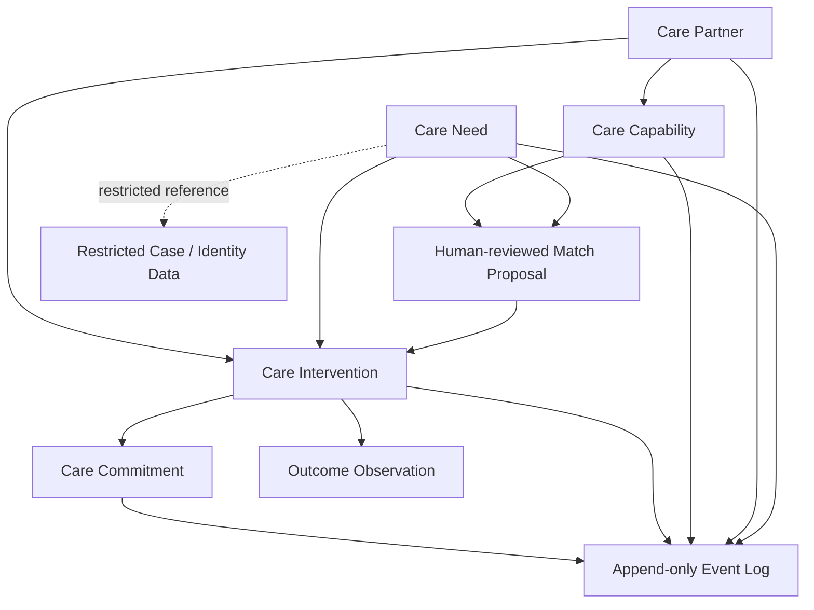

# M028 — Orione Principles & Atlas Care Domain Foundation

**Status:** In progress — documentation-only design; review pending  
**Date:** 2026-11-19  
**Decision:** [ADR 0023 — Atlas Care Domain Boundary and Human-Dignity Guardrails](../decisions/0023-atlas-care-domain-boundary.md)  
**Repository:** `ObiwanKenobee/qrpay-web-new-file-v5.7.0`  
**Base:** `main`  
**Branch:** `sanctum-scan/m028-orione-atlas-care-architecture`

## 1. Objective

Translate the user-supplied Orione research brief into a reviewable technical foundation for **Atlas Care — The Human Flourishing & Regenerative Action Network**, as a bounded domain within the existing Sanctum Scan Laravel application.

M028 is a design and governance milestone. It does not implement a Care feature, create a database table, or authorize a migration. Its output is a set of decisions and implementation constraints that must be reviewed before the first Care schema is written.

The product objective is to connect legitimate human needs with relevant human and institutional capabilities, coordinate accountable commitments, preserve evidence of what happened, and learn whether interventions strengthen people's stability, agency and opportunity.

## 2. Source basis and design traceability

The source basis is the user-supplied research brief **“The Orione Principle: Engineering a Civilization of Charity.”** M028 preserves the brief's terminology and conceptual structure; it does not claim to be a complete historical or theological study of St. Luigi Orione.

### 2.1 Seven source principles

| Source principle | M028 engineering interpretation |
|---|---|
| Charity is the greatest commandment | Human flourishing is the design objective; product success is not measured only by activity or revenue |
| Spend life for the poor and abandoned | Direct attention to underserved people and communities without turning hardship into a commercial targeting asset |
| Make ourselves loveable | Build trustworthy, understandable and accountable technology and institutions |
| The poor, sick and abandoned are our masters | Design with people experiencing hardship; include their voice in priorities, choices and evaluation |
| Do all the good you can | Enable distributed participation and coordinated contributions |
| Have faith and trust Divine Providence | Practice long-term stewardship, resilience and responsible innovation |
| See Jesus in every person in need | Treat human dignity as a non-negotiable architectural principle |

The source makes a further distinction that must remain explicit: technology cannot manufacture Christian love; it can help people express compassionate action more consistently and effectively.

### 2.2 Five constitutional principles

1. **Dignity before efficiency.** Never sacrifice human dignity for optimization.
2. **Service before extraction.** Communities are not markets to exploit.
3. **Participation before prescription.** People participate in designing their own solutions.
4. **Accountability before claims.** Impact claims require supporting evidence.
5. **Empowerment before dependency.** Assistance should expand human capabilities.

### 2.3 Six capabilities

The source brief identifies six capabilities. M028 assigns each a prospective domain responsibility:

| Capability | Proposed responsibility |
|---|---|
| Human needs intelligence | Capture and understand needs across food/nutrition, water/sanitation, healthcare/disability inclusion, education/employment, housing/family welfare and environmental restoration |
| Regenerative intelligence | Support analysis, resource-gap detection and evidence-informed recommendations |
| Community connectivity | Represent willing individuals, families, churches, SACCOs, NGOs, businesses, universities and public institutions |
| Regenerative resource allocation | Coordinate goods, skills, equipment, food, land, transport, volunteers, institutional support and (only after separate financial review) money |
| Accountability and verification | Track commitments, delivery declarations, evidence, reviews and outcomes |
| Regenerative development | Learn whether interventions strengthen self-sufficiency, opportunity, institutional capacity and lasting prosperity |

## 3. Current repository baseline and implementation gap

The following are repository findings, not proposed features:

| Area | Current evidence | M028 implication |
|---|---|---|
| Application architecture | Laravel modular monolith; see `ARCHITECTURE.md` | Add a bounded Care domain, not another application |
| API authentication | Passport guards `api`, `merchant_api`, `agent_api`; Sanctum is installed but not used for route protection | Preserve the current authentication stack |
| Persistence | MySQL deployment configuration | Do not introduce a database migration or database-platform change in M028 |
| QR references | `ScanReferenceIssuer` stores opaque reference hashes and supports expiry/revocation | Reuse the reference pattern only through an explicitly safe public projection |
| Public resource resolver | `ScanReferenceResolver` specializes merchant, product and agricultural-batch projections | Community-project resolution remains a design/implementation gap |
| Resource registry | `SanctumScanResource` represents merchant-owned products and agricultural batches | Do not overload the existing product/batch model with private welfare cases |
| Exchange workflow | `SanctumScanExchange` and related services preserve participant exchange history | Reuse selectively; a Care intervention is not automatically a commercial exchange |
| Evidence and verification | Existing private evidence, verifier mandates, attestations and provenance records | Define Care-specific purpose and authority before reusing a verifier workflow |
| Care domain | No Care models, Care services or Care migrations on the examined `main` branch | The domain is proposed, not implemented |

### 3.1 Important QR distinction

`ScanReferenceIssuer::RESOURCE_TYPES` includes `community_project`. However, the current resolver's specialized branches cover merchant, product and agricultural-batch resources. An allowed token type is not proof of a complete resource lifecycle, authorization policy or public data projection.

Before a public project QR can be issued, a later implementation design must define project ownership, publish/unpublish controls, archival and revocation, response fields, cache behaviour, safe contact details and privacy review.

### 3.2 Branch and milestone reconciliation

The repository contains a sequence of dependent milestone branches and merged pull requests. M028 must not assume that every feature developed in a dependent M023–M025 branch is already integrated into `main`.

Before runtime work begins, maintainers must reconcile the current `main` ancestry, the M023–M025 branch stack and the M026/M027 changes already merged to `main`. This is a branch-integration task, not a reason to copy dependent-branch code into M028.

The M025 Nakuru potato exchange pilot is a separate commercial value-chain test. It must not be presented as an Atlas Care beneficiary pilot, evidence of partner readiness, or proof of a Care workflow.

## 4. Target architecture

### 4.1 Placement

The proposed bounded context is:

```text
app/
├── Models/
│   ├── SanctumScanCareNeed.php
│   ├── SanctumScanCarePartner.php
│   ├── SanctumScanCareCapability.php
│   ├── SanctumScanCareIntervention.php
│   ├── SanctumScanCareCommitment.php
│   └── SanctumScanCareEvent.php
│
└── Services/
    └── SanctumScan/
        ├── ScanReferenceIssuer.php
        ├── ScanReferenceResolver.php
        └── Care/
            ├── CareNeedManager.php
            ├── CarePartnerManager.php
            ├── CareCapabilityManager.php
            ├── CareMatchingService.php
            ├── CareInterventionManager.php
            └── CareOutcomeRecorder.php
```

This is an illustrative namespace and class map. M028 does not create these files. Class names, model boundaries and transaction ownership must be confirmed during implementation design.

### 4.2 Logical relationship model



Rules:

- One intervention may respond to one or more related needs, but the reason for combining them must be visible to the coordinator and affected participants.
- A capability is declared by a partner; it is not proof that the partner owns the resource or can legally contribute it.
- A match is a proposal, not an accepted obligation.
- A commitment records what a named contributor agreed to provide and by when.
- The event log is cross-cutting audit history, not a sixth aggregate root. Aggregate/application services own invariants and append the corresponding event within the same transaction where the event describes a committed state change.
- Outcome observations describe change; they do not by themselves establish that the intervention caused the change.
- Restricted identity/case information is linked through a controlled reference rather than embedded in public resource or event payloads.

## 5. Domain responsibilities and minimum data concepts

The following are design concepts for review, not approved SQL columns.

### 5.1 Care Need

Purpose: record a need or opportunity in a way that is understandable, assessable and consent-aware.

Candidate concepts:

- Stable internal identifier and non-identifying public reference (only if a safe public use is later approved).
- Category and short description.
- Source and submitter/recording role.
- Coarse geographic area where necessary.
- Urgency/impact assessment with stated reasons and author.
- Status and status history.
- Consent/notice reference and recording timestamp where appropriate.
- Restricted case reference when identifying details are necessary.

Do not make beneficiary names, phone numbers, medical details or precise household coordinates ordinary fields on a publicly readable need record.

### 5.2 Care Partner

Purpose: represent an organization or accountable community entity that can participate in a specific scope.

Candidate concepts:

- Organization name and type.
- Public description and publication status.
- Verification/relationship status with its evidence basis.
- Authorized representatives and their scope/expiry of authority.
- Operating areas and declared service categories.
- Contact channel with disclosure rules.
- Suspension, withdrawal and review history.

An organization profile is not itself proof of legal status, charitable registration, professional qualification, or suitability for every intervention. A representative grant must be independently recorded with the account, partner, scope, permitted actions, issuer, evidence basis, effective period, expiry and revocation state. Current authority must be re-checked on every request; expiry/revocation blocks new access immediately while historical actions retain an immutable actor/authority snapshot. A user may hold different scopes for different partners, but no scope is implied by merchant ownership or email address.

### 5.3 Care Capability

Purpose: describe what a partner says it can contribute.

Contribution types from the source brief include:

- Money (not enabled in the first prototype; separate financial review required).
- Skills and professional expertise.
- Services.
- Time and volunteers.
- Equipment and tools.
- Food and other goods.
- Land, transport and logistics.
- Institutional support and knowledge.

Candidate concepts:

- Owning/declaring partner.
- Capability category and description.
- Quantity/unit where meaningful.
- Availability window and broad service area.
- Capacity/constraints.
- Evidence or source of declaration.
- Current availability status.

A capability record is a declaration of availability, not an inventory guarantee or a completed commitment.

### 5.4 Care Intervention

Purpose: represent a bounded, coordinated response.

Candidate concepts:

- Linked need or needs.
- Purpose and intended participants.
- Accountable coordinator/partner.
- Planned activities and timeline.
- Required capabilities.
- Approval record and responsible human decision-maker.
- Status and reason for material status changes.
- Intended outcome observations.

An intervention may include referrals, in-kind support, services, skills development, environmental work or institutional coordination. It must not imply that the platform itself delivers a service it only refers to.

### 5.5 Care Commitment

Purpose: record a specific promise by a named contributor.

Candidate concepts:

- Contributor and authority.
- Linked intervention.
- Contribution type and description.
- Quantity/unit or effort where appropriate.
- Due date or service window.
- Acceptance by the relevant coordinator/recipient where applicable.
- Fulfilment status and supporting event/evidence references.
- Withdrawal, partial fulfilment or dispute reason.

A commitment is not fulfillment. A commitment involving money is not a financial transfer.

### 5.6 Care Event Log (cross-cutting record, not an aggregate root)

Purpose: preserve the minimum necessary history of consequential actions. The log is not an independently mutable aggregate and does not own Need, Partner, Capability, Intervention or Commitment state.

Candidate concepts:

- Subject type and subject identifier.
- Event type and concise description.
- Actor guard/type and authenticated actor identifier.
- Actor's role/authority at the time.
- UTC timestamp.
- Evidence class and source reference.
- Minimal structured event metadata.
- Correction/supersession link when applicable.

Event payloads must not contain direct identifiers, contact details, health/welfare narratives, exact household locations, raw document contents or payment credentials. Store a pseudonymous subject reference only where needed. Append the event in the same database transaction as the state change it records; do not publish external side effects from inside a transaction. If later delivery to queues or integrations is required, design a transactional outbox separately. The design must reconcile append-only history with per-class retention, subject-reference unlinking, file deletion, backup expiry and lawful deletion/anonymization requirements.

## 6. Access, authority and information classification

### 6.1 Information classes

| Class | Examples | Default access |
|---|---|---|
| Public project information | Approved project purpose, publishing partner, broad area, public progress summary | Public, only after publication review |
| Partner operational information | Capability availability, assigned intervention, partner coordination notes | Authorized partner representatives and assigned coordinators |
| Participant-private information | A participant's own submissions, choices and commitments | The participant and specifically authorized case personnel |
| Restricted case information | Identity/contact details, health or welfare details, exact location, safeguarding notes | Named personnel with a documented need to access |
| Restricted evidence and review | Uploaded documents, reviewer notes, verification material | Explicitly authorized reviewers and participants only where the process permits |

### 6.2 Access matrix

| Actor | Permitted purpose | Explicit restriction |
|---|---|---|
| Public visitor | View approved public project information | No individual need, beneficiary identity, case, private evidence or payment information |
| Participant / person seeking support | Submit, view and correct their own permitted information; make choices about participation | No access to unrelated participants or confidential partner records |
| Community coordinator | Assess and coordinate assigned needs/interventions | Only the minimum case information required for assigned work |
| Partner representative | View assigned referrals, capabilities and commitments within their delegated authority | No bulk beneficiary discovery or access to unrelated case files |
| Evidence reviewer / independent verifier | Review evidence within a specific mandate | No broad access beyond mandate; conflict declarations and mandate scope apply |
| Administrator | Operate approved governance and support workflows | Admin status alone is not justification for unrestricted case access |
| Automated process | Perform explicit, bounded technical tasks | No autonomous eligibility, deservingness, disbursement or adverse decision |

The existing user, merchant, agent and admin guards remain the authentication foundation. The detailed partner-to-account mapping and role/permission implementation must be approved before routes are added. The authorization contract must specify grant creation, approval, renewal, expiry, revocation, delegated sub-grants (or explicitly prohibit them), conflict handling, query scoping and audited exceptional access. A generic partner role without intervention/need scope is insufficient.

## 7. Workflow and candidate states

### 7.1 End-to-end workflow

```text
DISCOVER
   |
   v
UNDERSTAND
   |
   v
CONNECT
   |
   v
MOBILIZE
   |
   v
VERIFY
   |
   v
REGENERATE
   |
   +------> new needs, capabilities or intervention learning
```

### 7.2 Candidate state vocabulary

The following state labels are design candidates, not final enum values or transition contracts.

| Object | Candidate states |
|---|---|
| Need | submitted, under_review, accepted_for_action, referred, addressed, closed, withdrawn |
| Partner | pending_review, active, suspended, inactive, withdrawn |
| Capability | declared, available, partially_available, committed, unavailable, withdrawn |
| Intervention | proposed, approved, active, paused, completed, cancelled, reviewed |
| Commitment | proposed, accepted, partially_fulfilled, fulfilled, withdrawn, disputed |

Before implementation, each state machine must define:
- Which actor can request each transition.
- Which authority is required.
- What evidence or acknowledgement is required.
- Whether the transition is reversible.
- How conflicts and concurrent changes are handled.
- Which events are written atomically with the state change.
- How correction and appeal are recorded.

Do not ship a generic status-update endpoint that lets a caller supply arbitrary statuses.

## 8. Matching and regenerative intelligence

### 8.1 First implementation: transparent human matching

The first prototype should use explicit rules and human review rather than model-generated eligibility decisions.

Possible matching dimensions:

- Need category and requested type of support.
- Declared capability category.
- Availability and capacity.
- Broad geographic service area and reasonable logistics.
- Required skills or qualifications, where applicable.
- Accessibility and communication requirements.
- Timing and intervention constraints.
- Partner authority and current verification status.

Every suggested match must show why it was suggested, which information was used, what is missing and which human must make the next decision.

### 8.2 Human triage, fairness and challenge controls

Matching is a feasibility aid, not a deservingness or eligibility score. The first prototype must not compute or persist a universal scalar score, use hidden weights, or silently sort individuals by predicted worth. Show the criteria used, the capability and timing constraints that matched, material missing information and any exclusions. Use only information necessary for the stated task; sensitive attributes must not be used as proxies for priority. Accessibility information may be used to arrange an accommodation when necessary and appropriately disclosed, not to reduce a person's opportunity. If urgency-based triage is required, the pilot owner must publish the criteria, record the human decision and rationale, monitor for disparate outcomes, and provide a correction/challenge path. Human review must not become a rubber stamp for an automated recommendation.

### 8.3 AI assistance — future capability

AI may later:

- Summarize long submissions.
- Suggest categories and identify missing fields.
- Find potentially relevant partner capabilities.
- Identify resource gaps at an aggregated level.
- Summarize event histories and outcome observations.

AI must not:
- Decide whether a person is deserving of help.
- Reject or deprioritize an individual without a human decision and reviewable reason.
- Infer a person's worth from income, health, disability, religion, family status or other sensitive traits.
- Make commitments, certify delivery or authorize money movement.
- Generate an impact claim unsupported by source evidence.

For any future AI-assisted recommendation, retain the source references, material assumptions, model/prompt version, limitations, human decision and reason. A human must be able to reject the recommendation without penalty.

## 9. Evidence, verification and outcome measurement

### 9.1 Evidence classes

| Class | What it means | What it does not prove |
|---|---|---|
| Participant-reported | A participant stated that something happened or is needed | Independent truth or delivery |
| Partner-declared | A partner declared an action, capability or delivery | Independent receipt or outcome |
| Source-record observed | An authorized reviewer inspected a named source record | More than the fields and context actually observed |
| Platform/operator reviewed | A platform reviewer recorded a bounded decision | Legal certification or external institutional authority |
| Independent attestation | A verifier made a statement within a defined mandate | Truth outside that mandate |
| Outcome observation | A measured or reported change after an intervention | Causation by the intervention without an appropriate evaluation design |

SHA-256 hashes may protect integrity of stored/exported bytes. They are not digital signatures, trusted timestamps, proof of identity or proof that an underlying claim is true.

### 9.2 Initial performance indicators

The source brief proposes outcome-oriented indicators rather than registration counts. The initial measurement framework should consider:

- Verified needs addressed.
- Percentage of commitments fulfilled.
- Time between identifying a need and responding.
- Resources delivered and accounted for.
- Household stability, only where a safe and appropriate measure exists.
- Access to education, healthcare or livelihoods.
- Accessibility and participation across disability groups.
- Community satisfaction and trust.
- Percentage of interventions with sustained outcomes.

For each indicator, define numerator, denominator, period, source, evidence class, missing-data treatment, privacy threshold and responsible reviewer. Report self-reported and independently reviewed figures separately. Do not claim causation from a small uncontrolled pilot.

## 10. Privacy, consent and safeguarding requirements

Before any live collection of personal or sensitive data, the pilot owner and qualified privacy reviewer must determine:

1. Who is the data controller and which parties are processors or independent controllers.
2. The purpose and lawful basis for each data field and processing operation.
3. Whether consent is relied upon, how it is explained, recorded, withdrawn and evidenced.
4. What information can be collected by a partner instead of copied into Atlas Care.
5. Who can view, change, export or delete information.
6. Retention periods for active records, inactive cases, evidence and audit references.
7. How access, correction, objection, complaints and deletion requests are handled.
8. Whether a Data Protection Impact Assessment or additional safeguards are required.
9. Incident reporting, safeguarding escalation and emergency procedures.
10. How participation remains voluntary and refusal/withdrawal does not remove access to unrelated services or entitlements.

M028 makes no legal determination about applicable law, controller status, lawful basis or DPIA requirement. Obtain qualified advice for the selected pilot before collecting live personal data.

### 10.1 Consent, notice and processing-basis separation

A consent record and a lawful-basis determination are different things and must not be represented by one boolean or one generic `consented` status. For every data purpose, document the accountable controller/processor roles, purpose, required notice, basis determined by qualified review, data categories, recipients, retention, rights channel and any sharing. Where consent is relied upon, record the specific version and explanation presented, affirmative choice, recording method, actor/time, withdrawal and downstream effect. Where another basis is determined, do not fabricate a consent event; retain the required notice and basis decision. Do not make optional consent a condition of unrelated services or entitlements.

### Minimum technical safeguards for later implementation

- Default-deny authorization and explicit participant/partner scoping.
- Private storage for restricted evidence; no public storage URLs for case files.
- Opaque references only in QR payloads.
- No direct identifiers or sensitive case details in logs, analytics, public exports or QR responses.
- Field-level minimization and a documented retention policy per data class.
- Rate limits and audit records for sensitive reads and mutations.
- A pseudonymous subject reference separated from the identity/contact mapping; prefer partner-held identity where feasible and safe.
- A defined correction, access, export, objection, withdrawal and erasure/anonymization workflow, including files and backups.
- Explicit actor identity from the authenticated guard, never caller-supplied actor IDs.
- Secure corrections, withdrawal and erasure/anonymization procedures.
- No bulk search of individual beneficiaries by the public.

### 10.2 Safeguarding, complaints and operational escalation

Before live collection, the pilot operator must name a trained safeguarding lead, define safe referral/escalation routes and make the platform's limits explicit. The platform must not imply it provides emergency response, clinical care or statutory case management. Participants need an accessible complaint and challenge channel independent of the partner or coordinator whose action is being challenged. The pilot-specific procedure for children and adults at risk must be defined by a qualified safeguarding owner; do not assume that a guardian or partner representative is always authorized to consent or receive information. Do not launch collection of safeguarding-sensitive case data without trained human capacity to respond.

## 11. Accessibility, connectivity and geography

The source brief calls for inclusive participation and offline functionality. M028 converts these into design requirements, not an immediate PWA implementation.

The later interface should be mobile-first, responsive, low-bandwidth aware, understandable in plain language, keyboard and screen-reader accessible, and usable through an assisted workflow. The design must consider users who share devices, have limited data/connectivity or cannot independently use a smartphone.

Offline capture, when separately designed, must distinguish locally captured/pending records from server-confirmed records. Conflict resolution, device authorization, revocation, synchronization order, duplicate submissions and replay prevention must be specified before any consequential offline action is supported.

Precise household coordinates are not required by default. Begin with coarse area or service-area matching unless an assessed use case requires finer precision.

## 12. Integration boundaries

| Existing capability | Potential reuse | M028 restriction |
|---|---|---|
| ScanReferenceIssuer / Resolver | Opaque public project references | No public beneficiary or private need resolution; project resolver contract must be designed separately |
| SanctumScanResource | Existing merchant product/batch records | Do not overload product/batch with Care Need or private case data |
| Exchange lifecycle | Commercial exchange between buyer and seller | Do not force every Care intervention into a bilateral purchase/order |
| Exchange event recorder | Append-only actor-attributed history pattern | Define Care event semantics and privacy before reuse |
| Private evidence subsystem | Private file handling, hashes and authorized downloads | Apply least-privilege case/evidence scope and retention policy |
| Verifier registry and mandates | Independent verification where a defined mandate exists | A verifier's authority is purpose-specific, not universal |
| Existing Passport guards | Authenticate current users, merchants and agents | No new `auth:sanctum` guard in M028 |
| Existing admin role/2FA | Restricted operations and review | Do not create blanket access to all case data |
| Payment gateways and wallets | No M028 integration | No payment, wallet, ledger or provider call |

Any integration that changes the financial, identity, authorization or evidence invariants requires a separate ADR and tests.

## 13. API and interface design constraints

M028 does not finalize route names, request payloads or response schemas. The later implementation design must provide these contracts before route creation.

Expected interface areas:

- Need submission and participant-owned view/correction.
- Restricted coordinator triage and assessment.
- Partner registration and representative management.
- Capability declaration and availability updates.
- Human-reviewed match proposals.
- Intervention approval, progress and completion.
- Commitment acceptance, fulfilment, withdrawal and dispute.
- Evidence submission and mandate-scoped review.
- Outcome observation and aggregate reporting.
- Public project information, only after safe publication rules are implemented.
- Participant correction, challenge, complaint and withdrawal requests.
- Safeguarding concerns and controlled human referral/escalation.

Every write must authenticate the actor, verify their current authority, scope the subject, validate the state transition, write the event in the same transaction where appropriate, and return only fields permitted for that audience.

## 14. Explicit non-goals

M028 and the first Care prototype do not include:

- A separate microservice or separate Care application.
- Replacement of Passport with Laravel Sanctum.
- A new wallet, charity bank account, escrow, lending, pooled savings or financial ledger.
- Automatic charitable disbursement or payment-provider integration.
- AI eligibility scoring, deservingness ranking or autonomous allocation.
- Public beneficiary profiles or precise household maps.
- A generalized identity platform or a new organization authentication guard.
- A universal trust score.
- Blockchain or tokenized assets.
- Mandatory PostGIS, PostgreSQL, Redis, vector databases or a new queue platform.
- A full mobile application or offline financial transaction authorization.
- Nationwide launch or claims of measurable social impact before a real pilot.

## 15. Delivery sequence after M028 review

M028 is complete only when the design is reviewed and the acceptance gate below is recorded. It does not create the next functional milestone automatically.

Proposed sequence:

1. **M028 review:** accept/revise/reject ADR 0023 and approve the design boundaries.
2. **Implementation design:** create a separate milestone with exact domain contracts, subject-reference/identity boundary, state transitions, delegation and revocation semantics, safeguarding/appeal paths, authorization tests, retention/erasure plan and migration plan.
3. **Small prototype:** implement only the minimum need/partner/capability/intervention workflow needed for one qualified pilot use case.
4. **Operational pilot:** proceed only after partner qualification, participant notice, privacy/safeguarding review, staff training and a baseline are complete.
5. **Evaluation:** publish measured results with denominators, evidence classes, limitations and unresolved harms/risks.

No live participant data should be collected merely to demonstrate the interface.

## 16. M028 deliverables

- [x] Source principles and six capabilities extracted into engineering requirements.
- [x] Six-stage operating cycle captured.
- [x] Proposed Care bounded context, five aggregate roots and cross-cutting event log documented.
- [x] Public QR versus private case boundary documented.
- [x] Existing Laravel, Passport, MySQL and Sanctum Scan boundaries recorded.
- [x] Human decision, evidence and AI guardrails documented.
- [x] Accessibility, low-bandwidth and offline constraints documented.
- [x] No-migration / no-runtime-change restriction recorded.
- [ ] ADR 0023 reviewed and accepted.
- [ ] Access/authority matrix and time-bounded delegation/revocation model approved by maintainers.
- [ ] Pseudonymous subject-reference and separate identity boundary approved.
- [ ] Privacy basis/notice/consent distinction, retention, correction, erasure and safeguarding approach reviewed for the selected pilot.
- [ ] Complaint, challenge and appeal path approved.
- [ ] Initial pilot use case, safeguarding owner and partner-operating model qualified.
- [ ] Separate implementation milestone approved.

## 17. Acceptance criteria and review gate

M028 may be marked **Implemented** as a documentation milestone only when:

1. ADR 0023 and this engineering specification agree on the domain boundary and guardrails.
2. Reviewers accept the five aggregate roots and cross-cutting event-log boundary or record explicit revisions.
3. Public project data, participant-private data, pseudonymous subject references, restricted identity/case data and evidence classes have distinct access rules.
4. Partner representation, time-bounded delegated authority and immediate revocation are defined without assuming a new auth guard.
5. Human decisions and evidence classes are defined for need triage, matching, commitments, delivery and outcomes.
6. The AI restrictions are testable as product requirements.
7. The no-money-movement boundary is explicit.
8. Processing basis and notice are distinguished from consent; retention, access, correction, objection, withdrawal, erasure/anonymization and safeguarding are assigned for detailed privacy review before live data.
9. No Care migration, model, controller, route, API, dependency, auth change or payment integration is included in M028.
10. The normal documentation/link review is complete and the PR has been reviewed.

### Review record

| Review area | Reviewer decision | Notes / required changes |
|---|---|---|
| Domain boundary and aggregate model | Pending | |
| Authentication and partner authority | Pending | |
| Public/private data boundary | Pending | |
| Evidence and verification semantics | Pending | |
| AI and human-decision guardrails | Pending | |
| Subject reference, identity boundary and processing basis | Pending |
| Partner delegation and revocation | Pending |
| Privacy, consent, retention, correction and safeguarding | Pending |
| Complaints, challenge and appeal | Pending | |
| Financial boundary | Pending | |
| Accessibility and low-connectivity design | Pending | |
| Initial pilot fit | Pending | |

**Migration gate:** no database migration may be authored until the ADR is Accepted, this specification has passed review, and a separately numbered implementation milestone has an approved schema, authorization, privacy, migration and test plan.

## 18. Validation

M028 is documentation-only. Validation consists of:
- Markdown structure and link/path review.
- ADR numbering and index consistency.
- Cross-checking repository paths and stated current behavior.
- Confirming that the branch diff contains only the intended documentation files.

No PHP test, migration test or application behavior is claimed by this milestone. At the time of this review, the GitHub Actions static/full-suite and MySQL gate jobs associated with the M028 merge commit reported failure and exposed no usable step/log detail through the connector; therefore no CI pass is claimed. The normal repository CI remains required for merge policy; it is not replaced by this documentation review.
